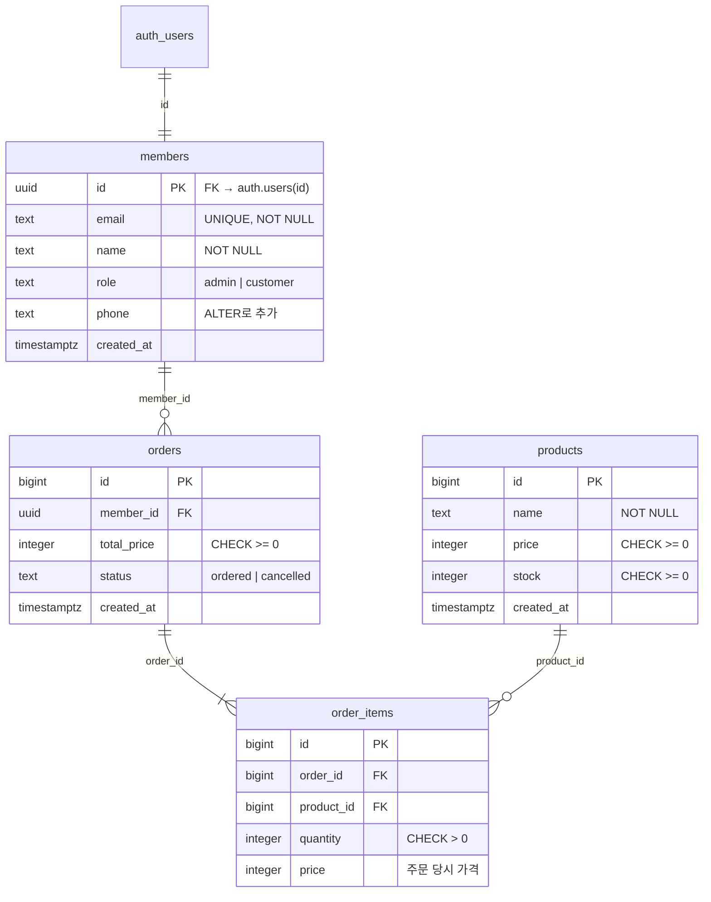
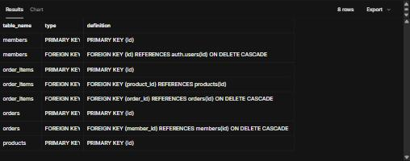
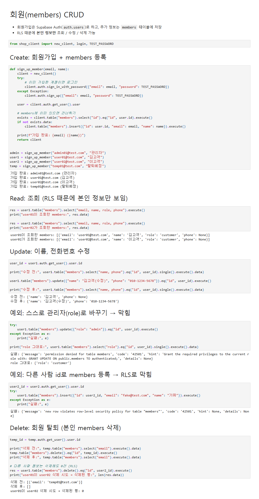
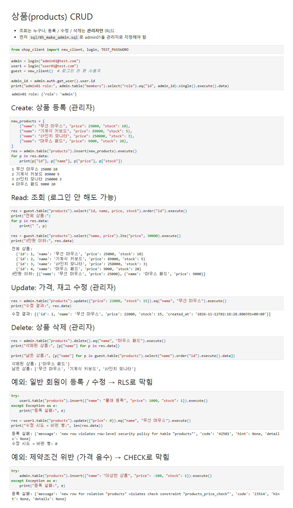
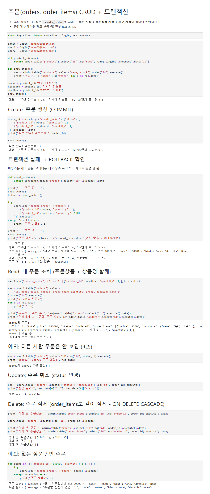

# 쇼핑몰 DB (Supabase) - 회원 / 상품 / 주문 CRUD

uv로 만든 Python 프로젝트에서 Supabase(PostgreSQL)에 회원, 상품, 주문 테이블을 만들고 CRUD를 구현했습니다.

## 프로젝트 구조

```
sql/
  01_schema.sql        테이블 생성 (CREATE / ALTER / DROP, PK, FK, 제약조건)
  02_rls.sql           RLS 권한 정책
  03_transaction.sql   주문 트랜잭션 함수 (COMMIT / ROLLBACK)
  04_check.sql         PK / FK 확인용 조회
  05_make_admin.sql    관리자 지정
shop_client.py         Supabase 연결 (.env 사용)
01_members.ipynb       회원 CRUD
02_products.ipynb      상품 CRUD
03_orders.ipynb        주문 CRUD + 트랜잭션
```

## 실행 방법

1. Supabase 프로젝트 생성 → Authentication에서 **Confirm email** 끄기
2. SQL Editor에서 `sql/01_schema.sql` → `02_rls.sql` → `03_transaction.sql` 실행
3. `.env.example`을 복사해서 `.env` 만들고 URL, anon key, 테스트 비밀번호 입력
4. `uv sync` 후 `01_members.ipynb` 실행
5. SQL Editor에서 `sql/05_make_admin.sql` 실행
6. `02_products.ipynb` → `03_orders.ipynb` 실행

## 테이블 구조



| 테이블 | PK | FK |
|---|---|---|
| members | id | id → auth.users(id) ON DELETE CASCADE |
| products | id | - |
| orders | id | member_id → members(id) ON DELETE CASCADE |
| order_items | id | order_id → orders(id) ON DELETE CASCADE<br>product_id → products(id) |

- 주문 1건에 상품이 여러 개 들어갈 수 있어서 `order_items`로 분리했습니다. (정규화)
- 명명 규칙: 테이블은 복수형 snake_case, PK는 `id`, FK는 `<단수>_id`

**PK / FK 조회 결과 (`sql/04_check.sql`)**



## 권한 (RLS)

| 테이블 | 조회 | 등록 | 수정 | 삭제 |
|---|---|---|---|---|
| members | 본인 (관리자는 전체) | 본인 | 본인 (이름, 전화번호만) | 본인 |
| products | 누구나 | 관리자 | 관리자 | 관리자 |
| orders | 본인 (관리자는 전체) | `create_order` 함수 | 본인 | 본인 |

회원이 스스로 `role`을 admin으로 바꾸지 못하게 `name`, `phone` 컬럼에만 UPDATE 권한을 줬습니다.

## 트랜잭션

`create_order` 함수 하나에서 **주문 저장 → 주문상품 저장 → 재고 차감**을 처리합니다.
함수는 하나의 트랜잭션으로 실행되기 때문에, 중간에 재고 부족 등으로 에러가 나면 앞에서 저장한 것까지 모두 ROLLBACK 됩니다.

- 재고 확인할 때 `select ... for update`로 잠가서 동시에 주문해도 재고가 꼬이지 않게 했습니다.
- SQL Editor에서 직접 `begin; ... commit;` / `begin; ... rollback;` 해보는 예시는 `sql/03_transaction.sql` 아래쪽에 있습니다.

## 실행 결과

### 회원 CRUD


### 상품 CRUD


### 주문 CRUD + 트랜잭션 (재고 부족 시 ROLLBACK)

